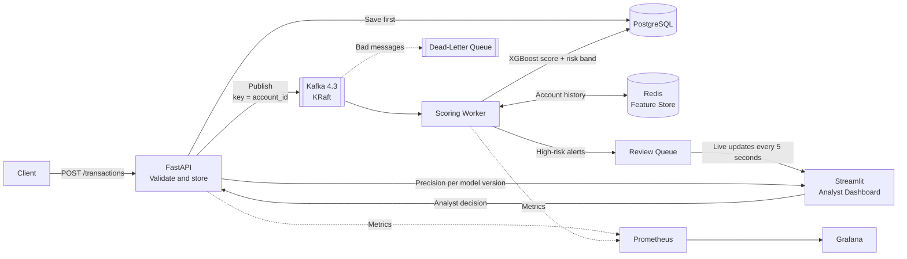

# FraudStream AI


**Real-time fraud detection for payment transactions**, built with FastAPI, Kafka, Redis, PostgreSQL, and XGBoost.

FraudStream AI accepts payment transactions through a FastAPI service, queues events in Kafka, computes behavioural features using Redis, and scores transactions with an XGBoost model. High-risk transactions appear in a live analyst dashboard, where investigation decisions feed back into model evaluation.

Prometheus and Grafana monitor the service, streaming pipeline, and model behaviour. A **champion-vs-challenger promotion gate** ensures a candidate model meets performance guardrails before replacing the deployed model.

Runs locally with one Docker Compose command and is deployed on **AWS EC2**.

## Architecture



### End-to-end workflow

Replay transactions → validate using the Pydantic data contract → calculate behavioural features using Redis → score with XGBoost → assign a risk band → create review alerts → record analyst decisions → evaluate model performance.

Model evaluation is available through:

```http
GET /reviews/summary
```

### Transaction lifecycle

```text
received → queued → scored → reviewed
```

- **received:** Transaction accepted and persisted.
- **queued:** Transaction published to Kafka; API returns HTTP `202`.
- **scored:** Worker calculates features and generates a fraud score.
- **reviewed:** Analyst records a decision for a high-risk transaction.

## Results

The following results are from the synthetic dataset and recorded model experiments.

**Source:** `artifacts_meta/fraud_model_v1.json` (deployed model) and `mlflow.db` (baselines).

### Model comparison

| Model (chronological split) | Validation average precision | Test average precision | Test recall at high band | Traffic flagged (test) |
|---|---:|---:|---:|---:|
| Rule baseline | 0.269 | — | — | — |
| Logistic regression | 0.679 | — | — | — |
| **XGBoost (deployed)** | **0.976** | **0.955** | **100% (75/75)** | **2.4%** |

Only the selected model is evaluated on the test set, once, after thresholds are frozen using validation data.

At the high-risk threshold, 75 of 354 flagged test transactions were fraud, giving approximately **21% precision among flagged transactions**. This threshold catches all 75 fraud cases in the test set.

### Deployed model – Test-set performance

| Metric (14,845 transactions, 75 fraud cases) | Result |
|---|---:|
| PR-AUC | **0.955** |
| Recall at 1% false-positive rate | **0.987** |
| Estimated fraud cost | **₹17,700** |
| Fraud amount caught by review queue | **₹4,82,041** |
| Single-transaction model latency (laptop CPU) | **p95 7–15 ms** |

Estimated fraud cost includes missed fraud, ₹500 per chargeback, and ₹50 per review.

### Champion vs. challenger

The script `scripts/compare_models.py` evaluates a candidate model against the deployed champion on the same test data.

A candidate is promoted only when it:

- Is no worse on PR-AUC.
- Is no worse on recall at 1% false-positive rate.
- Does not increase analyst workload beyond the guardrail.
- Does not violate the latency guardrail.
- Improves either estimated cost or PR-AUC.

**Recorded experiment:** A deeper XGBoost challenger achieved higher PR-AUC (0.957 vs. 0.955) and lower estimated cost, but caught one fewer fraud case at 1% FPR. It was rejected, and the deployed `v1` model remained the champion.

Details: [docs/model_promotion.md](docs/model_promotion.md).

### Engineering verification

| Engineering check | Result |
|---|---|
| Unit and integration tests | **115 passing** |
| CI | GitHub Actions on every push |
| Training/serving parity | Identical scores; maximum difference **0.0** |
| Single-event model latency (laptop CPU) | p95 approximately **15 ms** |
| End-to-end processing | Smoke test passes locally and on EC2 |

> **Dataset limitation:** The data is synthetic, with injected fraud patterns such as card testing and account takeover. These metrics demonstrate the system's pipeline and evaluation behaviour; they are not claims about real-world fraud rates or production performance.

## Key design decisions

| Decision | Reason |
|---|---|
| Save to PostgreSQL before publishing to Kafka | A Kafka outage does not lose an accepted transaction; retries can republish it. |
| Idempotent API using `transaction_id` as the primary key | Client retries do not create duplicate transactions. |
| Kafka message key = `account_id` | Events for an account remain ordered within a partition, supporting correct velocity features. |
| Shared feature function for training and serving | Prevents training/serving skew; verified through a parity test. |
| Point-in-time features and chronological data split | Prevents future information from leaking into training. |
| Manual Kafka offset commit after processing | Supports at-least-once delivery. |
| Dead-letter queue | Poison messages can be isolated instead of repeatedly blocking a partition. |
| Thresholds based on analyst capacity | Keeps the review queue within the approximate 2% workload budget. |
| Alembic migrations as a one-shot job | Ensures the database schema is ready before application services start. |
| Model monitoring | Tracks high-risk rate, score distribution, and analyst precision to detect silent model degradation. |
| Champion-vs-challenger promotion gate | Requires measurable improvement while preserving performance guardrails. |
| Dashboard reruns only when the alert set changes | New alerts appear within five seconds without unnecessarily wiping an analyst's partially written note. |

## Run locally

### Requirements

- Docker Desktop
- Python 3.12 (for development and scripts)
- Git

### 1. Clone the repository

```bash
git clone https://github.com/MohdAsif-AIML25/fraudstream-ai.git
cd fraudstream-ai
```

### 2. Configure environment

```bash
cp .env.example .env
```

Set your own passwords and required environment variables in `.env`.

### 3. Create and activate a Python environment

**Windows PowerShell:**

```powershell
python -m venv .venv
.\.venv\Scripts\Activate.ps1
```

**Linux/macOS:**

```bash
python -m venv .venv
source .venv/bin/activate
```

### 4. Install development dependencies

```bash
pip install -r requirements-dev.txt
```

The development requirements include runtime, training, and testing dependencies. The Docker application image uses `requirements.txt`.

### 5. Generate data and train models

Run these steps when reproducing the training pipeline:

```bash
python -m scripts.generate_dataset
python -m scripts.build_features

python -m scripts.train_baselines
python -m scripts.train_xgboost
python -m scripts.select_model
```

### 6. Start the application

```bash
docker compose up -d --build
```

This starts the configured infrastructure, database migrations, API, worker, dashboard, and monitoring services.

### 7. Run the smoke test

```bash
python -m scripts.smoke_test
```

### 8. Replay transactions

```bash
python -m scripts.replay --limit 300 --rate 5
```

Replay a fraud-heavy slice to observe alerts appearing in the live dashboard:

```bash
python -m scripts.replay --skip 11367 --limit 600 --rate 20
```

### 9. Train and evaluate a challenger

Train a candidate model:

```bash
python -m scripts.train_xgboost --name xgboost_v2 --max-depth 6
```

Compare it with the deployed champion:

```bash
python -m scripts.compare_models --candidate artifacts/xgboost_v2.joblib
```

The candidate is promoted only if it satisfies the configured champion-vs-challenger guardrails.

## Application URLs

| Service | Local URL | Purpose |
|---|---|---|
| FastAPI Swagger | [http://localhost:8000/docs](http://localhost:8000/docs) | API documentation and endpoint testing |
| Streamlit Dashboard | [http://localhost:8501](http://localhost:8501) | Live analyst review queue and model precision |
| Grafana | [http://localhost:3000](http://localhost:3000) | Monitoring dashboards |
| Prometheus | [http://localhost:9090](http://localhost:9090) | Metrics, targets, and alerts |

## AWS deployment

FraudStream AI is deployed on **AWS EC2 using Ubuntu and Docker Compose**.

The deployment uses SSH local port forwarding to access application services from the local machine without directly exposing their application ports to the public internet.

The configured local access URLs are:

- FastAPI: `http://localhost:8000/docs`
- Review dashboard: `http://localhost:8501`
- Grafana: `http://localhost:3000`
- Prometheus: `http://localhost:9090`

Deployment instructions:

- [AWS Deployment Guide](docs/aws-deployment.md)
- [Execution Checklist](docs/execution-checklist.md)

## Monitoring

FraudStream AI monitors three layers, with **12 dashboard panels and 6 alert rules**.

Runbook: [docs/runbook.md](docs/runbook.md).

### 1. Service monitoring

- Service availability.
- API request rate.
- p95 request latency.
- HTTP 5xx error rate.

### 2. Pipeline monitoring

- Kafka worker throughput.
- Transaction acceptance-to-scoring time.
- Dead-letter queue activity.

### 3. Model monitoring

- High-risk transaction rate against the 2% review budget.
- Prediction score distribution and drift indicators.
- Precision on analyst-reviewed transactions.

### Dashboard screenshots

Add deployment screenshots to the repository:

```text
docs/images/grafana.png
docs/images/review-queue.png
```

## Tech stack

| Category | Technologies |
|---|---|
| Language | Python 3.12 |
| API | FastAPI, Pydantic |
| Database | PostgreSQL, SQLAlchemy 2, Alembic |
| Feature store | Redis |
| Streaming | Apache Kafka 4.3 (KRaft) |
| Machine learning | XGBoost, scikit-learn |
| Experiment tracking | MLflow |
| Monitoring | Prometheus, Grafana |
| Dashboard | Streamlit |
| Infrastructure | Docker Compose, AWS EC2 |
| CI/CD | GitHub Actions |

## Project structure

```text
fraudstream-ai/
│
├── app/
│   ├── schemas/       # Pydantic transaction data contracts
│   ├── features/      # Point-in-time features: offline and Redis
│   ├── data/          # Synthetic data generation
│   ├── models/        # Training, evaluation, and scoring
│   ├── api/           # FastAPI: ingestion, status, reviews
│   ├── worker/        # Kafka consumer and scoring worker
│   ├── streaming/     # Kafka topics, messages, and producer
│   ├── monitoring/    # Prometheus metrics
│   ├── db/            # SQLAlchemy database models
│   └── config.py      # Environment-based configuration
│
├── alembic/           # Database migrations
├── dashboard/         # Streamlit analyst review interface
├── scripts/           # Data, training, replay, and smoke tests
├── infra/             # Prometheus, alerts, and Grafana
├── tests/
│   └── unit/          # Unit and integration tests
├── deploy/            # EC2 setup and deployment scripts
├── docs/
│   ├── images/        # Project screenshots
│   ├── aws-deployment.md
│   ├── execution-checklist.md
│   ├── model_promotion.md
│   └── runbook.md
│
├── artifacts/         # Trained model artifacts
├── artifacts_meta/    # Model metadata
├── docker-compose.yml
├── requirements.txt
├── requirements-dev.txt
└── README.md
```

## Limitations and next steps

The project demonstrates a working end-to-end fraud detection pipeline. The following improvements remain:

1. **Transactional outbox:** If the API crashes between the database commit and Kafka publish, the transaction remains in `received` until the client retries. An outbox poller would publish it automatically.
2. **Retraining loop:** Analyst decisions are stored and evaluated per model version, but are not yet automatically used to train a new model.
3. **Shadow scoring:** Challenger models are compared offline. Running both champion and challenger against live traffic would provide additional production evaluation.
4. **Alert delivery:** Alerts are visible in Prometheus, but Alertmanager-based email or Slack notifications are not yet implemented.
5. **Scalability:** The current deployment uses a single Kafka broker and a single EC2 host. A larger production deployment could use managed services such as Amazon MSK, Amazon RDS, and Amazon ElastiCache, with multiple workers.

## License

[MIT License](LICENSE) © 2026 Mohammad Asif