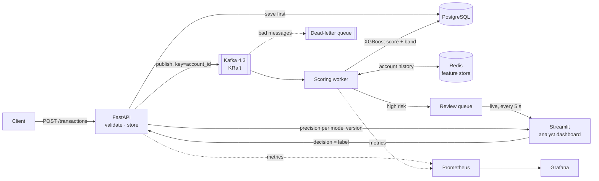

# FraudStream AI


Real-time fraud detection for payment transactions: a FastAPI service accepts transactions,
Kafka queues them, a scoring worker computes behavioural features from Redis and scores them with
an XGBoost model, high-risk alerts appear on a **live** analyst dashboard, analyst decisions flow back as
model evaluation, and Prometheus + Grafana monitor the service, the pipeline **and the model**. A candidate
model must beat the deployed one through a **champion-vs-challenger gate** before it can be promoted.
Runs with one command in Docker; deployed on AWS EC2.

## Architecture



**Workflow:** replay transactions → validate (Pydantic contract) → features (Redis) → score (XGBoost) →
threshold (risk band) → alert (review case) → investigator decision → model evaluation (`GET /reviews/summary`).

**Request lifecycle:** `received` → `queued` (API returns **202**) → `scored` (worker) → reviewed (analyst, if high risk).

## Results

<!-- Source: artifacts_meta/fraud_model_v1.json (deployed model) and mlflow.db (baselines). -->

| Model (chronological split) | Validation avg. precision | Test avg. precision | Test recall @ high band | Traffic flagged (test) |
|---|---|---|---|---|
| Rule baseline | 0.269 | — | — | — |
| Logistic regression | 0.679 | — | — | — |
| **XGBoost (deployed)** | **0.976** | **0.955** | **100 %** (75 / 75) | **2.4 %** |

Only the selected model is evaluated on the test set, once, after thresholds were frozen on validation.
At the *high* threshold, 21 % of flagged test transactions are fraud (75 of 354) — the price of catching all of it.

| Deployed model on the test set (14,845 txns, 75 fraud) | Value |
|---|---|
| PR-AUC | 0.955 |
| Recall at 1 % false-positive rate | 0.987 |
| Estimated fraud cost (missed fraud + ₹500 chargeback each + ₹50 per review) | ₹17,700 |
| Fraud amount caught by the review queue | ₹4,82,041 |
| Model latency, one transaction (laptop CPU) | p95 7–15 ms across runs |

### Champion vs. challenger

`scripts/compare_models.py` scores a candidate and the deployed model on the same test data and promotes the
candidate only if it is no worse on PR-AUC, recall @ 1 % FPR, analyst workload and latency **and** better on cost
or PR-AUC. Real run: a deeper XGBoost had higher PR-AUC (0.957 vs 0.955) and lower cost, but caught one fewer
fraud at 1 % FPR → **rejected, v1 kept**. Details: [docs/model_promotion.md](docs/model_promotion.md).

| Engineering check | Result |
|---|---|
| Unit + integration tests | **115 passing** (CI on every push) |
| Training/serving parity (online Redis features vs offline) | identical scores (max diff **0.0**) |
| Single-event model latency (one row, laptop CPU) | p95 ≈ 15 ms |
| End-to-end (API → scored) | smoke test passes locally and on EC2 |

> Data is **synthetic** with injected fraud patterns (card testing, account takeover), so the
> metrics show the pipeline works; they are not a claim about real-world fraud rates.

## Key design decisions

| Decision | Why |
|---|---|
| Save to Postgres **before** publishing to Kafka | a Kafka outage cannot lose an accepted transaction; retries republish |
| Idempotent API (transaction_id = primary key) | client retries never create duplicates |
| Kafka key = `account_id` | one account's events stay ordered in one partition → correct velocity features |
| **One** feature function for training and serving | no training/serving skew (proven by a parity test) |
| Point-in-time features, chronological split | no future data leaks into training |
| Manual offset commit after processing + DLQ | at-least-once delivery; poison messages don't block the partition |
| Thresholds from analyst capacity (top ~2%) | the review team can actually handle the queue |
| Alembic migrations as a one-shot job | schema is ready before any service starts |
| Model monitoring (high-risk rate, score distribution, analyst precision) | a model can be up and fast while silently wrong |
| Promotion gate: guardrails + required improvement | a new model must be better, not just different; rollback = one env var |
| Live dashboard reruns only when the alert set changes | new alerts appear within 5 s without wiping an analyst's half-typed note |

## Run locally

Requirements: Docker Desktop, Python 3.12 (only for the scripts).

```bash
cp .env.example .env                       # then set your own passwords
python -m venv .venv && source .venv/bin/activate   # Windows: .venv\Scripts\activate
pip install -r requirements-dev.txt        # runtime + training + tests (the Docker image uses requirements.txt only)
python -m scripts.generate_dataset         # one-time: data + model (Day 2-3 scripts)
python -m scripts.build_features
python -m scripts.train_baselines && python -m scripts.train_xgboost && python -m scripts.select_model

docker compose up -d --build               # everything: infra, migrations, api, worker, dashboard, monitoring
python -m scripts.smoke_test               # end-to-end check
python -m scripts.replay --limit 300 --rate 5
python -m scripts.replay --skip 11367 --limit 600 --rate 20   # a fraud-heavy slice: watch alerts appear live

python -m scripts.train_xgboost --name xgboost_v2 --max-depth 6            # a challenger
python -m scripts.compare_models --candidate artifacts/xgboost_v2.joblib   # champion vs. challenger
```

| URL | |
|---|---|
| http://localhost:8000/docs | API |
| http://localhost:8501 | live analyst review queue + model precision |
| http://localhost:3000 | Grafana dashboard |
| http://localhost:9090 | Prometheus (targets, alerts) |

Deployment on AWS: see [docs/aws-deployment.md](docs/aws-deployment.md).

## Monitoring

Three layers, 12 dashboard panels, 6 alert rules (runbook: [docs/runbook.md](docs/runbook.md)):

- **Service:** up/down, request rate, p95 latency, 5xx rate
- **Pipeline:** worker throughput, acceptance-to-score time, dead letters
- **Model:** high-risk rate vs. the 2% budget, score distribution (drift), precision on analyst-reviewed cases

<!-- Add screenshots: docs/images/grafana.png, docs/images/review-queue.png -->

## Tech stack

Python 3.12 · FastAPI · Pydantic · SQLAlchemy 2 · Alembic · PostgreSQL · Redis · Kafka 4.3 (KRaft) ·
XGBoost · scikit-learn · MLflow · Prometheus · Grafana · Streamlit · Docker Compose · GitHub Actions · AWS EC2

## Project structure

```text
app/
  schemas/      data contract (Pydantic)            features/   point-in-time features (offline + Redis)
  data/         synthetic data generator            models/     training, evaluation, scorer
  api/          FastAPI: ingest, status, reviews    worker/     Kafka consumer + scoring
  streaming/    Kafka topics, messages, producer    monitoring/ Prometheus metrics
  db/           SQLAlchemy models                   config.py   settings from .env
alembic/        database migrations                 dashboard/  Streamlit review UI
scripts/        data, training, replay, smoke test  infra/      Prometheus, alerts, Grafana
tests/unit/     115 tests                           deploy/     EC2 setup + deploy scripts
docs/           data contract, model promotion, alert runbook, AWS deployment guide
```

## Limitations and next steps

- **Transactional outbox:** if the API crashes between the DB commit and the Kafka publish, the row
  waits as `received` until the client retries. An outbox poller would publish it automatically.
- **Retraining loop:** analyst decisions are stored and measured per model version, but not yet used to train model v2.
- **Shadow scoring:** the challenger is compared offline; scoring live traffic with both models side by side would be the next step.
- **Alerting:** alerts are visible in Prometheus; no Alertmanager (email/Slack) yet.
- **Scale:** single Kafka broker and single EC2 host; production would use managed services
  (MSK, RDS, ElastiCache) and more than one worker.